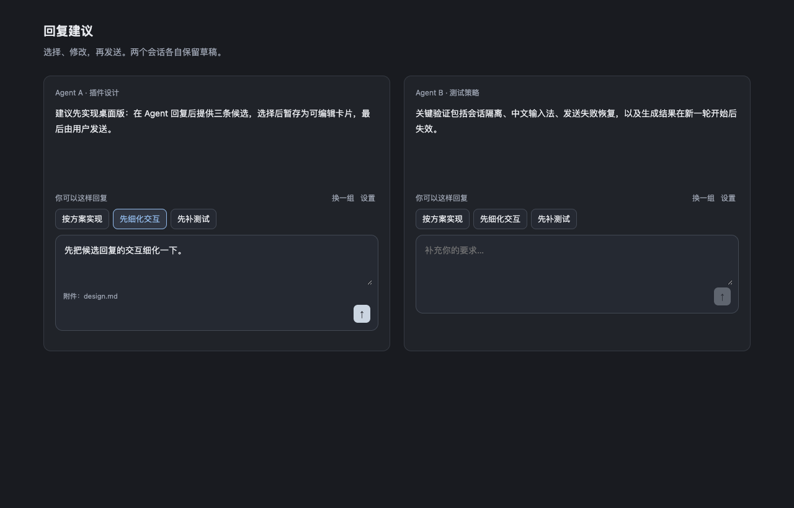

# Paseo 回复建议

Agent 完整回复后，在桌面输入区上方默认展示 3 个短文案候选按钮。点击按钮将完整候选填入 Paseo 原生输入框，可直接编辑并通过原生按钮或 Enter 发送。

默认读取 Paseo「主机 → 元数据」的模型配置，使用已有 Provider 登录生成候选，无需另填 API Key。支持中文、英文界面，默认跟随 Paseo；候选回复语言可单独设置。

上图来自 Chromium 模拟输入区验收，展示当前交互效果。验证范围见[验收记录](docs/verification.md)。

## 安装

当前预发布版本为 [v0.1.1](https://github.com/MinLeeV5/paseo-help-answer-plugins/releases/tag/v0.1.1)，面向 Paseo 0.12.0 及以上桌面端（`>=0.12.0`）。已验证 0.12.0 与 0.13.0-beta.1 的插件安装，实际桌面 Tab 切换验收使用 0.13.0-beta.1。目标主机需要启用插件、支持后台工作区，并已登录至少一个可用的 Provider。

在已安装 Paseo CLI 的终端执行：

    paseo plugin install https://github.com/MinLeeV5/paseo-help-answer-plugins.git --ref v0.1.1
    paseo plugin ls help-answer

确认插件已启用且状态为 `running`，然后打开桌面对话。等待新一轮 Agent 成功完成回复，或在当前对话的命令中心选择「生成回复建议」（Generate reply suggestions）。

通过 GitHub 安装后，可检查更新，或显式切换到本次固定版本：

    paseo plugin update help-answer --check
    paseo plugin update help-answer --ref v0.1.1

体验 main 分支的开发版本，可将安装命令中的 `--ref v0.1.1` 替换为 `--ref main`。

安装和更新命令默认操作本地主机；连接其他 daemon 时，可通过 `--host` 指定目标主机。

## 使用

1. 新一轮回复成功完成后自动生成候选；仅在生成完毕且存在候选时显示短按钮。没有候选、正在生成、生成失败或等待下一轮回复时，整个建议区域隐藏，独立的「回复建议」胶囊入口始终隐藏。
2. 点击短标题，将完整候选填入原生输入框并聚焦；直接在原输入框修改、补充或删除内容。
3. 点击 Paseo 原生发送按钮或按 Enter 发送。点击候选只填入，不会自动发送。
4. 有候选时可点击「换一组」重新生成，「设置」打开配置。安装前已有回复或关闭自动生成时，可在 Paseo 命令中心选择「生成回复建议」手动生成。

原输入框已有草稿时，候选放在前面，原稿保留在后面，以空行分隔。重复点击同一候选不会重复追加；切换候选只替换尚未改写的候选开头，保留后续补充。如果已改写候选开头，新选择会保留整段现有文字。发送时直接提交原生输入框的实际内容，原生附件流程继续生效。

普通输入和候选回复都在确认发送后收起建议区域，等待下一轮 Agent 完成回复并生成新候选。轮询返回的旧候选不会重新出现；发送失败保留完整草稿，补全和输入法操作交由原生输入框处理。

候选只用于对应 Agent 的当前查看过程。切换 Tab 或离开该 Agent 的输入区后，旧候选和选中标记失效，切回不会恢复；新一轮成功回复或从命令中心手动生成后重新显示。已填入输入框的草稿继续保留。分屏中仍然可见的 Agent 各自独立，同一 Agent 仍在另一窗格显示时保留其建议。

## 配置

在「设置 → 插件 → 回复建议 → 回复建议」修改后点击保存。

| 配置 | 默认值 | 说明 |
| --- | --- | --- |
| 界面语言 | 跟随 Paseo | 可固定为中文或 English；设置页、候选按钮与插件错误提示均支持两种语言 |
| 自动生成 | 开启 | 关闭后可在命令中心选择「生成回复建议」 |
| 候选数量 | 3 | 可选 2～5 条；没有足够合适的回答时允许更少 |
| 回复语言 | 跟随对话 | 也可固定简体中文或英文 |
| 模型覆盖 | 空 | 跟随元数据配置，或填写 provider/model |
| 附加生成要求 | 空 | 最多 2,000 字符；如「优先给出具体下一步，避免客套话」，在默认提示词中追加生效 |
| 默认提示词 | 内置，只读 | 展示实际使用的系统指令与生成模板，可选中复制，不能在设置中修改 |
| 最近对话 | 4 轮 | 可选 1、2、4、6、8、10 轮；仅用户与助手文本，合计最多 16,000 字符 |
| 超时 | 25 秒 | 可选 10、15、20、25 秒，包括队列与模型生成 |

模型选择按以下顺序处理：

1. 填写「模型覆盖」时，仅使用指定的 `provider/model`；不可用时生成失败。
2. 未覆盖且主机配置了元数据模型列表时，按列表顺序尝试可用项，不回退到列表外的模型。
3. 主机未配置列表时，按插件内置的小模型候选顺序查找已启用 Provider 的可用模型，最后尝试当前对话模型。

复用的是元数据模型配置与 Provider 登录，候选由插件自己的提示词和独立后台任务生成。模型调用计入所用 Provider 的正常用量。

界面语言默认跟随当前 Paseo 客户端的应用语言，其他语言回退到英文。界面语言与候选回复语言独立：候选默认仍跟随对话，也可单独固定为简体中文或英文。切换界面语言不会替换已有候选、编辑内容或输入框草稿，也不会单独触发模型调用。显式选择中文或 English 后点击保存，会覆盖插件界面的自动跟随；恢复默认设置会重新跟随 Paseo。Paseo 管理的设置导航标题随应用语言显示。

在 Paseo 0.12 中，建议区域和设置内容自动跟随应用语言；切换 Paseo 应用语言后，设置导航标题和命令名称需执行 `paseo plugin reload help-answer` 后更新。新版 Paseo 使用宿主提供的实时翻译接口。

默认提示词中的占位符会在生成时填入候选数量、回复语言、附加要求、上一组候选和对话正文。设置页只展示模板，不展示实际会话内容。提示词由客户端与服务端共用同一份定义；界面切换为中文时，仍展示实际使用的英文原文。原始 Provider / daemon 错误及模型生成的回复内容保持原样。

设置由同一 daemon 的客户端共享，保存在 Paseo 插件设置存储中。候选保存在 daemon 内存，按钮的选中标记只在当前客户端内存。填入内容成为 Paseo 原生草稿，其保存与恢复由 Paseo 管理；插件重载不会主动清空输入框。

## 生成与会话隔离

- 仅成功完成的轮次后生成；取消、失败、等待权限或正在运行时不生成。
- 创建独立后台工作区。生成任务只挂到该工作区内的专用服务会话，不挂到用户 Agent，不进入当前对话的子 Agent 列表。
- 服务会话不接收提示词、不执行模型轮次；实际生成任务使用 Paseo 对子任务的通知抑制规则，不触发额外的 Agent Finish 提示。普通用户 Agent 的完成提醒保留。
- 辅助任务带插件专属标签，避免递归生成；完成、失败或取消后归档生成 Agent、服务会话和工作区。
- 后台任务仍有普通历史，主动显示后台工作区或查看归档时可能看到记录。
- 同一 Agent 的请求合并，最多同时生成两个任务；新一轮开始后取消旧生成并丢弃迟到结果。
- 同一轮候选供不同客户端复用；各客户端的选择、编辑与原草稿独立。
- 不读取工具输出、推理文本或文件内容作为生成素材，不记录对话正文与候选内容日志。

## 桌面兼容性

原生输入框填入与发送确认通过桌面 DOM 适配层实现，代码集中在 [client/web.ts](client/web.ts)：

- 使用公开 Composer 胶囊的自有标记识别 Agent，不读取 React 私有状态。
- 始终隐藏胶囊的桌面按钮，同时保留身份标记；仅在候选就绪时显示短文案按钮。插件卸载时恢复宿主按钮样式。
- 定位 message-input-root 和 textarea[data-composer-input]，通过原生 input 事件同步文本。
- 点击候选通过原生 input 事件填入完整内容，发送时不再额外拼接，保留附件、中文输入法、Shift+Enter 与斜杠命令行为。
- 发送失败时保留完整草稿；输入区切换时解除发送锁，不向身份已变化的输入区恢复旧会话文字。
- 模型文字仅通过 textContent 或 textarea.value 渲染。

Paseo 输入区结构或发送按钮的无障碍标签变化时，需要检查此适配层。未找到匹配输入区时，插件不会尝试写入其他会话。

当前不支持原生 iOS / Android，未接入 Jev。

## 常见问题

**安装后为什么没有按钮？** 安装前已有回复不会立即触发自动生成。等待下一轮成功回复，或在当前对话的命令中心选择「生成回复建议」。没有候选和生成期间隐藏入口是预期行为；关闭「自动生成」后也需手动生成。

**生成失败如何排查？** 建议区域在失败时也会隐藏。可从命令中心手动生成，失败时会向 Paseo 返回错误；检查 Provider 登录、主机元数据模型和插件的模型覆盖设置。超时可尝试更快的模型。查看插件状态和日志：

    paseo plugin ls help-answer
    paseo plugin logs help-answer

**点击候选为什么没有填入？** 先结束中文输入法组词或输入框中的斜杠命令，并确认 Agent 未在运行、输入框可编辑。若宿主升级后仍无法填入，请检查桌面适配层。

## 开发与验证

本地开发需要 Node.js 22 或更新版本：

    git clone https://github.com/MinLeeV5/paseo-help-answer-plugins.git
    cd paseo-help-answer-plugins
    npm ci
    npm run typecheck
    npm test
    npx playwright install chromium
    npm run test:e2e
    npm run verify:install

将当前源码目录安装到本机 Paseo：

    paseo plugin install "$PWD"

本地修改后执行 `paseo plugin reload help-answer`。通过 GitHub 安装的副本使用前述 `paseo plugin update` 更新。本插件没有额外生产依赖；插件 SDK、React、React Native、Zod 由 Paseo 提供，package.json 中的依赖用于本地开发和验收。

开发依赖以 Paseo 0.12.0 SDK 为最低兼容基线。已完成 TypeScript 严格类型检查、39 项单元测试和 40 项 Chromium 输入区验收；另已验证 0.12.0 与 0.13.0-beta.1 的隔离安装，以及真实元数据模型调用、后台会话隔离、归档与辅助任务通知抑制、实际桌面的 Tab 切换失效行为。浏览器验收使用独立模拟 Composer，完整范围见[验收记录](docs/verification.md)。

- npm test：上下文裁剪、模型选择、结构化校验、会话隔离、去重、取消与归档。
- npm run test:e2e：真实 Chromium 中验证选择、编辑、原生提交、附件、失败重试、分屏、中文输入法、补全与脚本注入防护。使用独立模拟输入区，不发送真实用户消息。首次在没有 Chrome 的环境运行时，可先运行 npx playwright install chromium。
- npm run preview：在 http://127.0.0.1:4178 查看同一验收场景。
- npm run verify:install：将源码复制到没有 node_modules 的临时目录，在独立临时 daemon 上验证安装和 running 状态，完成后停止该 daemon 并清理目录。使用 `npm run verify:install -- --ref v0.1.1` 可验证 Git 标签安装；通过 `HELP_ANSWER_PASEO_CLI=/absolute/path/to/paseo` 指定待测 CLI，结果包含实际 CLI 版本；不调用模型。
- npm run verify:live：显式使用本机元数据模型，验证候选生成、后台隔离、服务会话归档和通知。通过普通会话完成事件验证通知通道有效，再检查辅助会话未发出提醒；会产生模型用量。仅处理脚本内置验收对话，并清理自己的资源。连接时使用本机 Paseo credential，该凭据不会打印或保存。

真实生成记录见[模型验收记录](artifacts/live-smoke.json)，内容仅为脚本内置验收对话的候选与检查结果。提示词与语言配置的只读检查见[设置检查记录](artifacts/settings-language-smoke.json)。

## 发布文档

- [v0.1.1 Release 说明](docs/releases/v0.1.1.md)
- [v0.1.1 发布流程](docs/releasing.md)
- [v0.1.0 Release 说明](docs/releases/v0.1.0.md)

插件目录介绍提供[英文默认页](OVERVIEW.md)与[简体中文译文](OVERVIEW.zh-CN.md)。

## 参考

- [Paseo 插件文档](https://paseo.sh/zh-CN/docs/plugins)
- [后台工作区](https://paseo.sh/zh-CN/docs/sdk/workspaces)
- [元数据生成](https://paseo.sh/zh-CN/docs/metadata-generation)
- [Annotations](https://github.com/neunzig-zehn/paseo-annotations)：桌面提交接入参考。本插件使用自有身份标记和服务端消息回执。
